# StoreShot

**Art-directed, RTL-first App Store & Google Play screenshots — from one JSON config, rendered locally.**

StoreShot composes your real app screenshots into premium marketing frames for every locale you ship — with **Arabic and right-to-left typography as a first-class design system**, deterministic offline rendering, and a validator that refuses to ship a clipped headline.

```bash
npx storeshot-cli init my-app
npx storeshot-cli generate
```

---

## The v0.2 creative system

Every frame is treated as a standalone marketing composition with a role in a sequence — not a screenshot pasted into a colored rectangle. Six art-directed templates, a realistic device renderer, magazine-grade typography, and sequence awareness:

| Template | Concept | Device |
| --- | --- | --- |
| `editorial` | Magazine opening page: masthead + folio, ghost numeral, serif display headline, device crossing the fold | framed front |
| `cinematic` | Hero product shot: key light, floor reflection, scrim — two alternating camera setups | framed front |
| `swiss` | International typographic style: visible grid, heavy accent bar, diagonal composition, figure caption | frameless |
| `campaign` | Launch poster: the largest headline in the library, solid brand tag, angled device breaking a diagonal band | 3D angled |
| `immersive` | Device in a scene: perspective twin devices, horizon, rim light, viewfinder ticks | 3D angled + twin |
| `showcase` | The interface is the hero: layered UI views breaking the edge of an elevated slab | frameless, layered |
| `discovery` | Apple-inspired product-page art direction: optional localized search layer, oversized ghost type, layered screens cropped by the canvas | framed + layered |

Consecutive frames **alternate between structurally different layouts** (centered vs asymmetric spreads, edge-cropped devices, typography behind objects), so a five-image listing reads like one campaign — and `screenshots[].prompt` feeds the Discovery template's localized search layer — same config, same pixels, every run.

## Gallery

All images below were rendered by this repository's CLI from the example project in [`starter/`](starter/) (the sample app "Qamar" is original StoreShot artwork). Full gallery: [`docs/gallery/`](docs/gallery), including a complete five-image campaign in English and Arabic, light themes, and every template. Before/after against v0.1: [`docs/before-after.md`](docs/before-after.md).

| Editorial (EN) | Editorial (AR) |
| --- | --- |
|  | 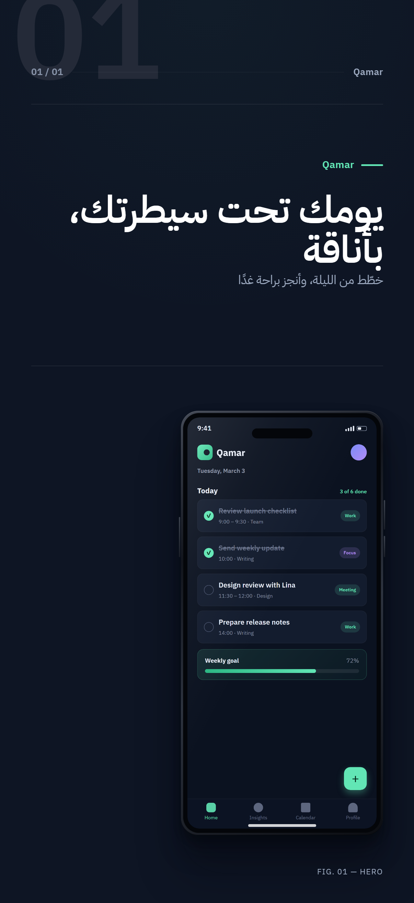 |

| Cinematic (EN) | Campaign (EN) |
| --- | --- |
| 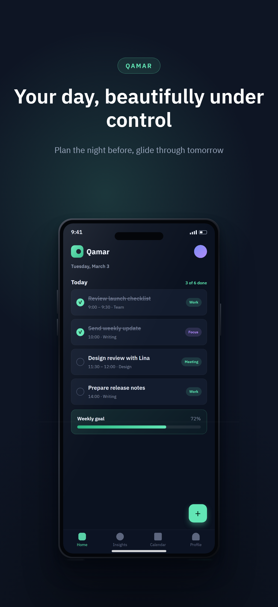 | 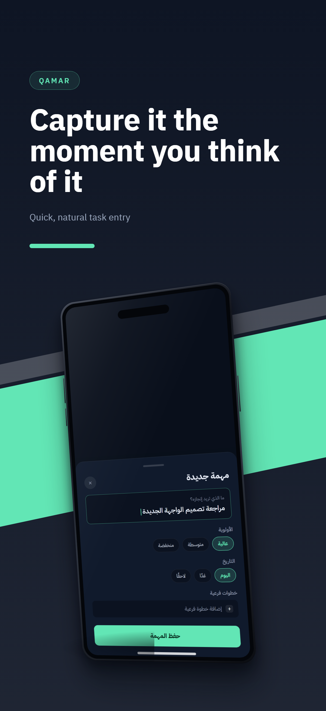 |

| Immersive (EN) | Showcase (AR) |
| --- | --- |
| 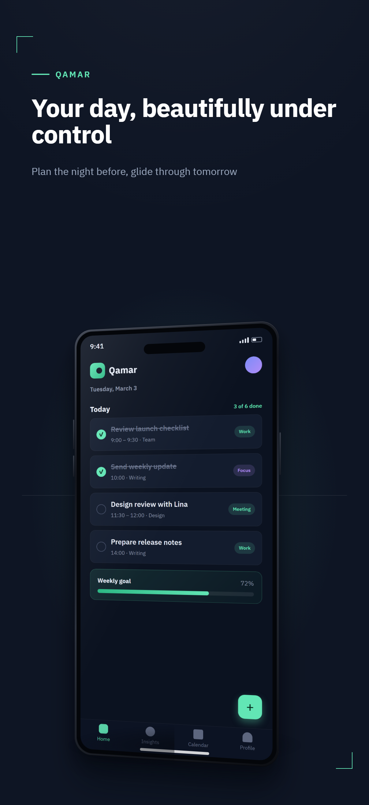 | 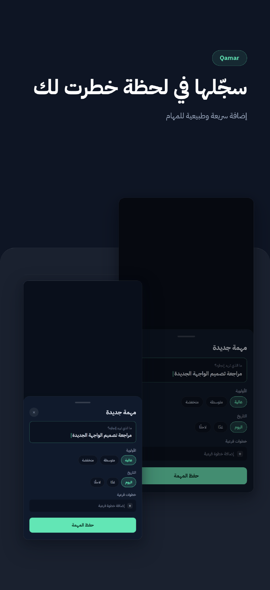 |

| Discovery (EN) — search layer + layered screens | Discovery (AR) — RTL variant B |
| --- | --- |
| 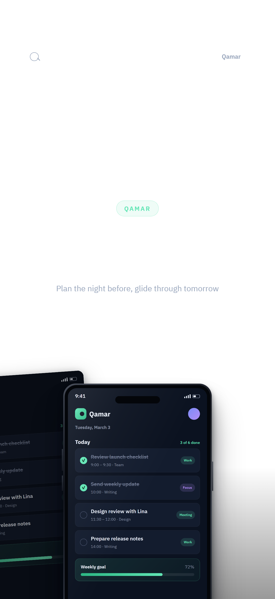 | 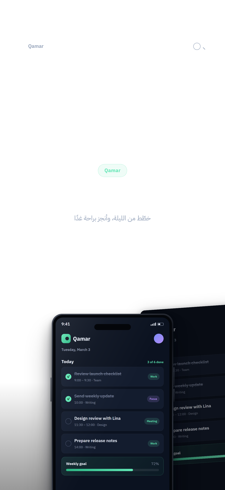 |

| Swiss (EN) | Editorial on paper (light) |
| --- | --- |
| 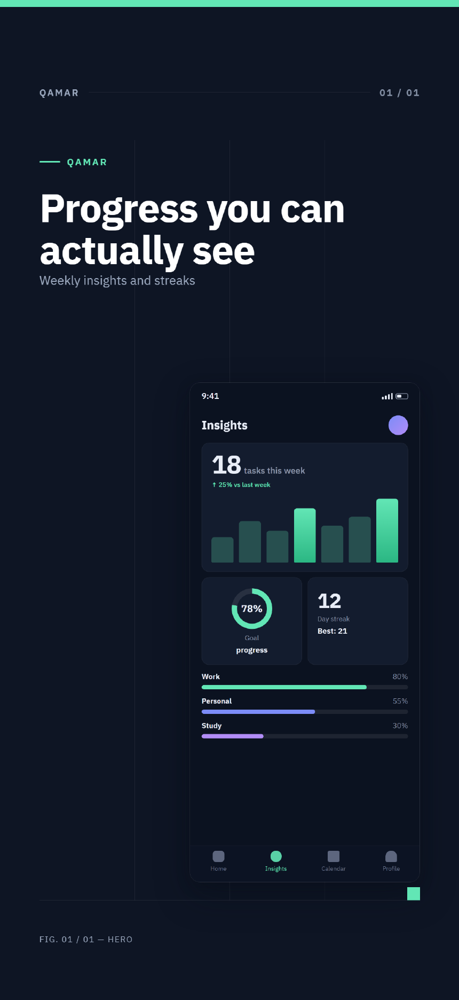 | 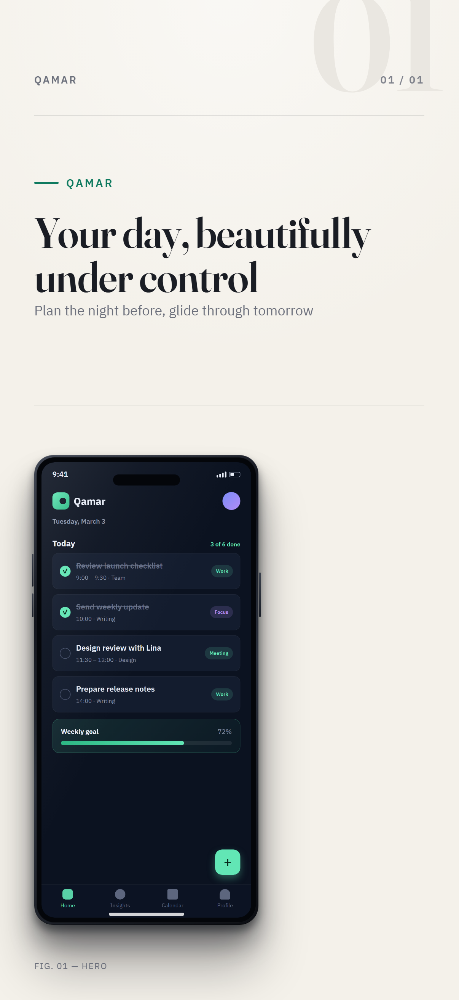 |

Rebuild it yourself:

```bash
git clone https://github.com/storeshot/storeshot && cd storeshot
npm install && npm run build && npx playwright-core install chromium
cd starter && node ../dist/cli.js generate
node ../scripts/build-gallery.mjs   # docs/gallery
```

## Arabic & RTL — designed, not translated

- Shaping, bidi and mixed Arabic/English/numerals are handled by Chromium's text engine (HarfBuzz + ICU); StoreShot never reorders or reverses strings.
- `<html lang dir>` comes from the locale; templates mirror via CSS logical properties — headlines, rules, grids and captions re-flow, while the app screenshot and device hardware stay un-mirrored.
- Direction-aware display stack: Arabic headlines set in **IBM Plex Sans Arabic** with embedded Latin words falling through to **Fraunces**, the bundled display serif (both SIL OFL 1.1, both shipped).
- Text is measured **after fonts load**; a headline that doesn't fit its budget fails the build with the screenshot id, locale and field — nothing is silently shrunk.
- Visual regression cases cover long Arabic headlines, multi-line subtitles, mixed-language copy with numerals and punctuation, and light/dark modes.

Troubleshooting guide: [`docs/rtl-guide.md`](docs/rtl-guide.md).

## Installation

```bash
npm install --save-dev storeshot-cli   # or: npx storeshot-cli@latest …
npx storeshot-cli install              # one-time Chromium download (~170 MB)
```

Requirements: **Node.js ≥ 20**, Windows / macOS / Linux. The npm package is `storeshot-cli` (the name `storeshot` was taken); the binary is `storeshot`. No installed Chromium? `STORESHOT_BROWSER_CHANNEL=msedge storeshot generate` (or `chrome`).

## Quick start

```bash
storeshot init my-app   # asks: app name, story, locales, template, theme
cd my-app
storeshot generate      # every locale × export, sequence-aware
storeshot validate      # config, assets, translations, rendered text fit
```

Replace the five example screenshots in `screens/` with your real app UI (PNG/JPEG/WebP), edit the copy in `storeshot.config.json`, done. StoreShot never modifies your screenshots — it composes the marketing around them.

## Configuration highlights

```jsonc
{
  "$schema": "./node_modules/storeshot-cli/schema.json",
  "app": { "name": "Qamar", "story": "A calm task manager for people who plan tomorrow the night before." },
  "locales": ["en-US", "ar"],
  "template": "editorial",
  "theme": { "background": "#0E1524", "accent": "#62E6B5", "text": "#FFFFFF", "mode": "auto" },
  "screenshots": [
    {
      "id": "home",
      "role": "hero",                     // semantic role, shown in captions
      "image": "./screens/home.png",
      "title": { "en-US": "Your day, beautifully under control", "ar": "يومك تحت سيطرتك، بأناقة" }
    }
  ],
  "exports": [
    { "store": "app-store", "profile": "iphone-6-3" },
    { "store": "google-play", "profile": "phone" }
  ]
}
```

- `screenshots[].role` — optional semantic role (`hero`, `feature`, `workflow`, `trust`…) used by captions and layouts.
- `theme.mode` — `auto` (derived from the background), `light` or `dark` to force shadow/contrast behavior; `theme.surface` overrides the elevated-panel token.
- Templates accept small, curated setting sets (`headlineScale`, `deviceScale`, `deviceMode`, and one or two template-specific options).

Full reference: [`docs/configuration.md`](docs/configuration.md) · Template API & authoring: [`docs/templates.md`](docs/templates.md).

## Apple creative assets: headers & search results

Apple's new product-page **header** and **search results** creatives are first-class exports — and because they are landscape, every template automatically switches to a dedicated landscape composition (text column + device column, RTL-aware):

| Header 21:9 (3840×1646) | Search results 3:2 (3840×2560) |
| --- | --- |
| 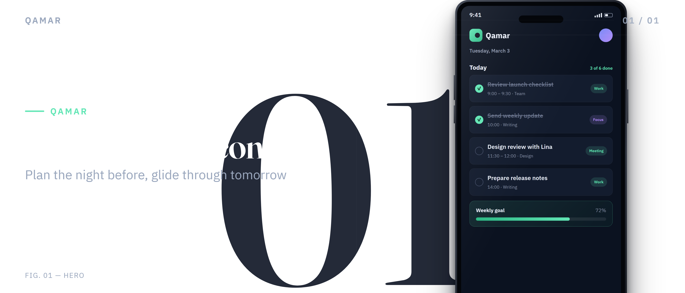 | 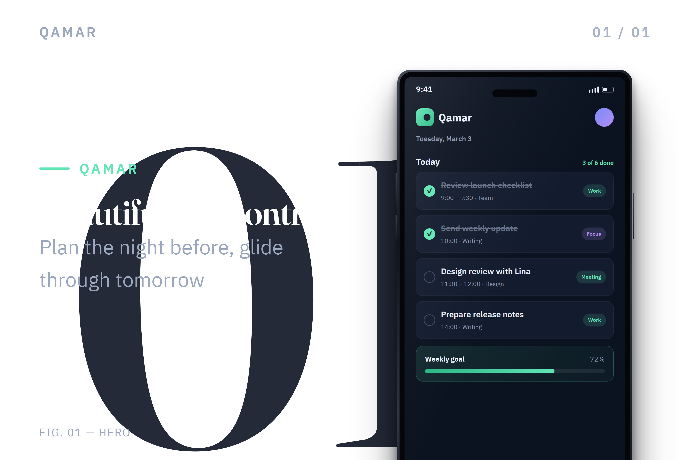 |

| Header in Arabic (RTL landscape) | Universal 16:9 (5244×2950, PNG-only) |
| --- | --- |
| 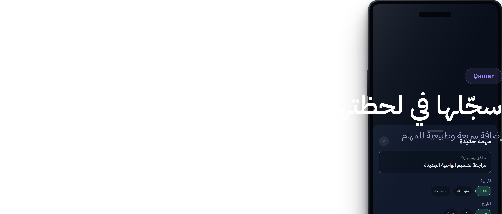 | 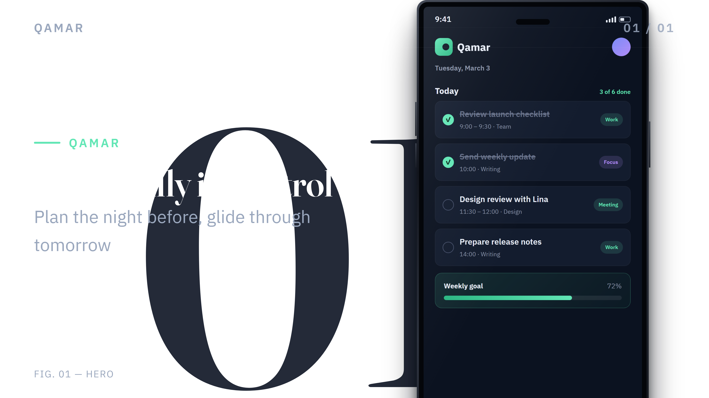 |

Google Play gets its own treatment too: the verified `feature-graphic` profile (1024×500) renders in the same landscape engine — see `docs/gallery/google-play/`. Apple profiles: `header-21-9`, `header-16-9` (one PNG covers header **and** search), `search-results-3-2`, plus `iphone-6-1` (1179×2556) and `preview-frame-6-3` (888×1920 poster frames — the preview itself must be video). Verified against Apple's official specifications on 2026-10-10 — see [`docs/store-profiles.md`](docs/store-profiles.md).

## Store profiles

Verified against official Apple/Google documentation (sources + dates in [`docs/store-profiles.md`](docs/store-profiles.md)): `iphone-6-3` 1206×2622 (required iPhone class), `iphone-6-9` 1320×2868, `ipad-13` 2064×2752, `phone` 1080×1920, `tablet` 1600×2560, plus validated custom sizes. Correct dimensions ≠ full compliance — the docs list what StoreShot cannot check.

## CLI & CI

```
storeshot init [dir] [--force] [--yes]    interactive project wizard
storeshot generate [-l locale…] [-e export…] [-o dir] [--allow-overflow]
storeshot validate [--json] [--fast]      config → assets → rendered text fit
storeshot templates                       the template library + settings
storeshot install                         download the rendering browser
```

Exit codes `0/1/2`; `validate --json` for pipelines; network requests are blocked inside the renderer; the same config + assets + version always produce the same pixels.

## What validation catches

Schema violations · missing/corrupt/unsupported/low-res sources · font fallbacks · missing translations (per screenshot, locale, field) · unknown templates, profiles and settings · custom-size rule violations · low title/background contrast · **rendered text overflow per locale × screenshot × export size**. It cannot judge taste or store policy — those stay yours.

## Development

```bash
npm install && npm run build && npx playwright-core install chromium
npm test              # 120 tests: unit + integration + visual regression
npm run test:visual:update   # refresh per-platform baselines deliberately
```

PRs welcome — new templates, verified store profiles, and Arabic/RTL edge cases above all. See [`CONTRIBUTING.md`](CONTRIBUTING.md) and the [template guide](docs/templates.md).

## License

[MIT](LICENSE). Bundled fonts — IBM Plex Sans, IBM Plex Sans Arabic, Fraunces — are SIL Open Font License 1.1 ([license texts](assets/fonts/_licenses/)).
