<div align="center">

# StoreShot

**App Store & Google Play screenshots that look designed — from one JSON config.**

An open-source CLI that turns your real app screenshots into art-directed store listings for every locale and device size. First-class **Arabic/RTL** support. **Local, reproducible rendering** — nothing leaves your machine.

[](https://www.npmjs.com/package/storeshot-cli)
[](https://www.npmjs.com/package/storeshot-cli)
[](https://github.com/saperaa/StoreShot/actions/workflows/ci.yml?query=branch%3Amaster)
[](https://github.com/saperaa/StoreShot/actions/workflows/publish.yml?query=event%3Arelease)
[](LICENSE)
[](./package.json)

[Gallery](#-template-gallery) · [Quick start](#-quick-start) · [Templates](docs/templates.md) · [Configuration](docs/configuration.md) · [Store profiles](docs/store-profiles.md) · [Arabic & RTL](docs/rtl-guide.md) · [Contributing](CONTRIBUTING.md)

</div>

---

## The flagship campaign

Every frame below was generated by this CLI from one config — real app screenshots, localized copy, deterministic output. Left: English value proposition. Right: Arabic workflow frame (RTL layout, connected letterforms).

| 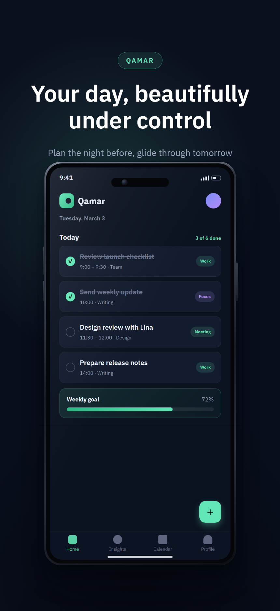 | 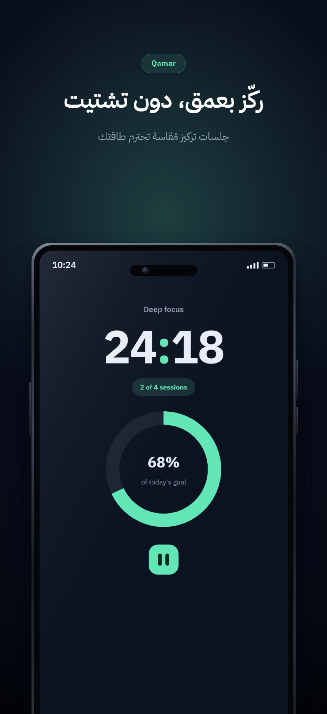 |

The complete five-frame listing — value proposition → feature → differentiator → workflow → product strength, in English and Arabic — lives in [`docs/gallery/flagship`](docs/gallery/flagship).

## Why StoreShot

- **One config, every asset.** Screenshots × locales × device sizes from a single `storeshot.config.json` — same pixels every run.
- **Local & free forever.** Renders offline with Chromium. No SaaS subscription, no uploads of your unreleased app, no API keys.
- **Real design, not frames around rectangles.** Fourteen art-directed templates across seven design families — including tilted-device posters, floating product scenes and layered depth compositions — with realistic device rendering and sequence-aware layouts.
- **Arabic/RTL done right.** Connected letterforms, mirrored compositions, mixed Arabic/English text — through Chromium's text engine, never string reversal.
- **Fails before you ship bad assets.** Validates config, translations, exact store dimensions, and rendered text fit — with browser-measured geometry checks.

## Quick start

```bash
npm install --save-dev storeshot-cli
npx storeshot install        # one-time Chromium download (~170 MB)
npx storeshot init my-app    # wizard: name, story, locales, template, theme
cd my-app
npx storeshot generate
```

Output lands in `storeshots/<store-profile>/<locale>/01-…png` at exact verified dimensions. Already have Chrome or Edge installed? Skip the download: `STORESHOT_BROWSER_CHANNEL=msedge npx storeshot generate`.

> Requires Node.js ≥ 20 · Windows / macOS / Linux. First render after `init` uses the bundled example app — replace `screens/*.png` with your real screenshots and edit the copy in `storeshot.config.json`.

## Template gallery

Fourteen templates across seven art directions — each direction is a distinct design system (typography, composition rules, background treatment, device presentation), not a background swap. The same app, screenshot and copy rendered through each family: [`docs/gallery/families`](docs/gallery/families) (English & Arabic, portrait and landscape headers, Play feature graphics).

| Family | Template | Concept |
| --- | --- | --- |
| Dark Cinematic | `cinematic` · `cinematic-3d` | Product-studio photography: key light, floor reflection; the 3D variant adds true perspective, extruded metal edges and a diagonal light shaft |
| Editorial Swiss | `editorial` · `swiss` | Magazine spread: masthead, ghost numeral, serif display type · typographic grid, frameless UI, figure caption |
| Bold Brand Campaign | `campaign` | Launch poster: oversized type, angled device, brand band |
| Warm Premium | `atelier` | Cream paper, ink serif typography, hairline plate margins, warm ambient shadows |
| Vibrant Gradient | `aurora` | A structured two-tone light field with a luminous diagonal ridge — direction, not wallpaper |
| Minimal Product | `linea` | Near-white field, one hairline line, plinth device presentation, restrained type |
| Dynamic Composition | `tilt` · `float` · `strata` | 2D-rotated device bleeding off the corner · optional transparent decor orbiting at alternating depths · layered slab, ring, device and raised headline card |

Plus `discovery` (Apple-inspired, localized search layer), `immersive` / `showcase` (perspective twin devices · layered UI on a slab).

| Family | English | العربية |
| --- | --- | --- |
| Dark Cinematic | 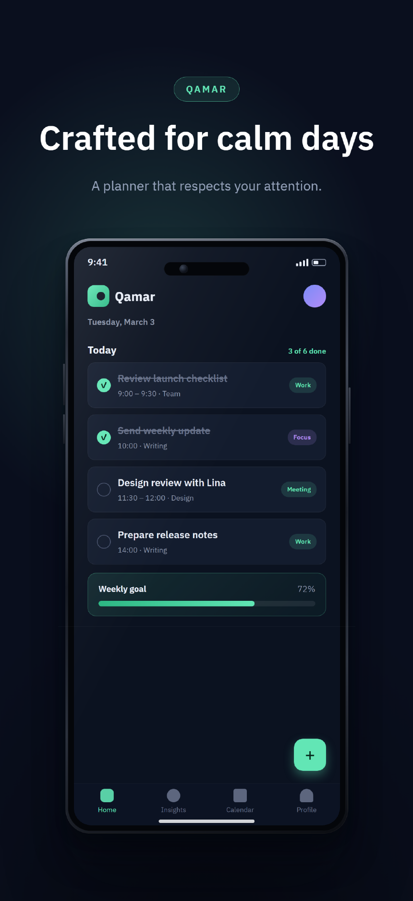 | 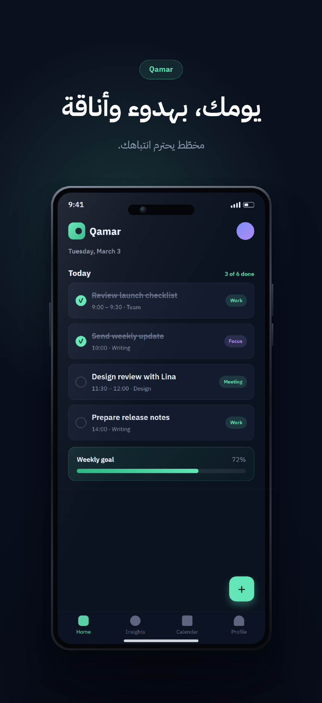 |
| Bold Campaign | 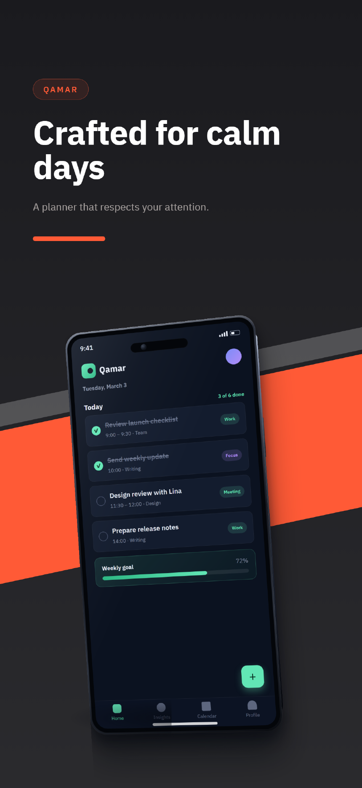 | 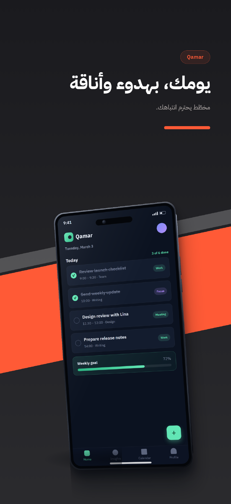 |
| Warm Premium | 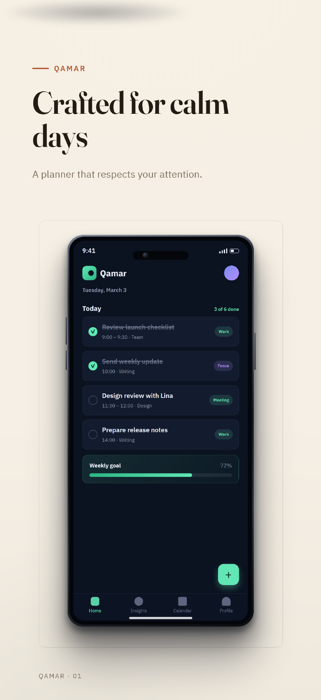 | 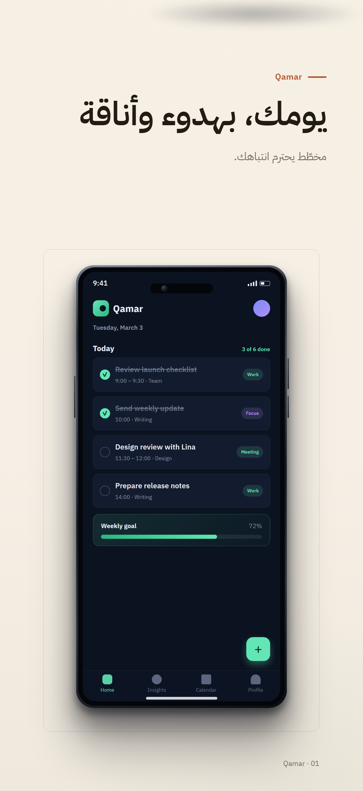 |
| Vibrant Gradient | 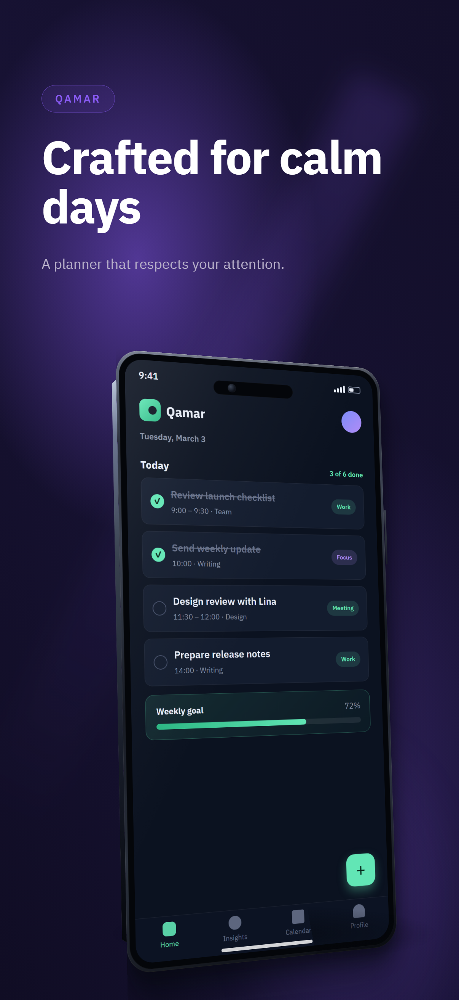 | 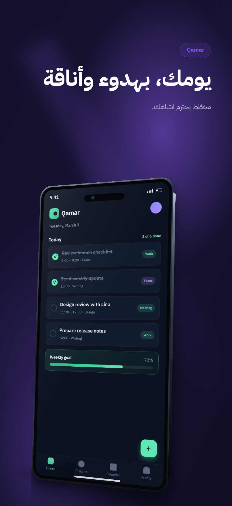 |
| Minimal Product | 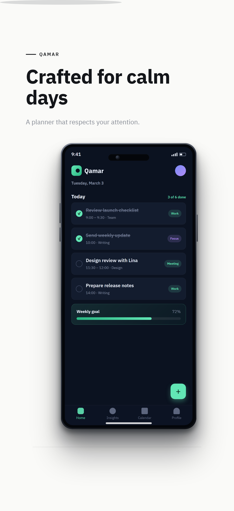 | 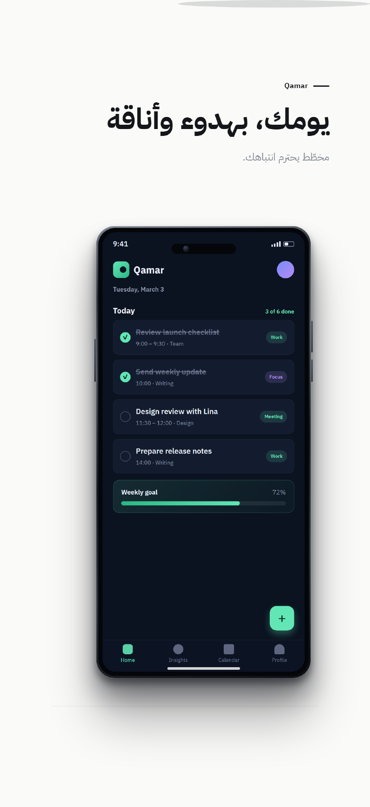 |
| Editorial Swiss | 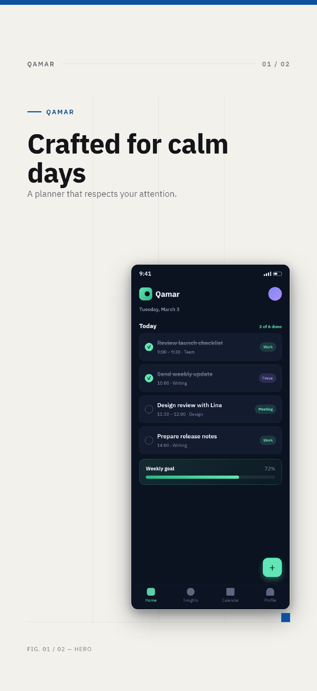 | 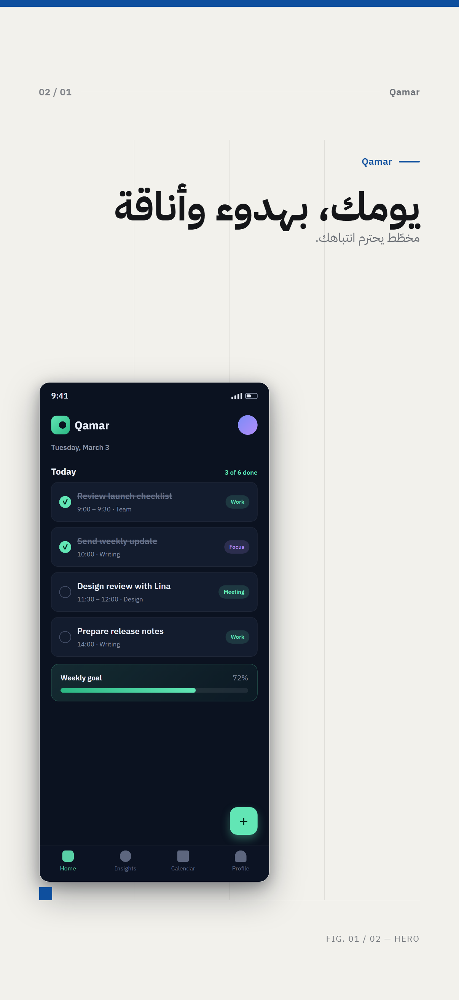 |
| Dynamic Composition | 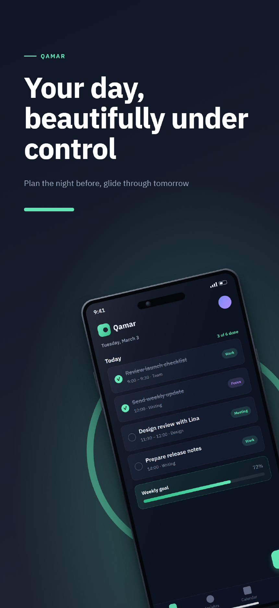 | 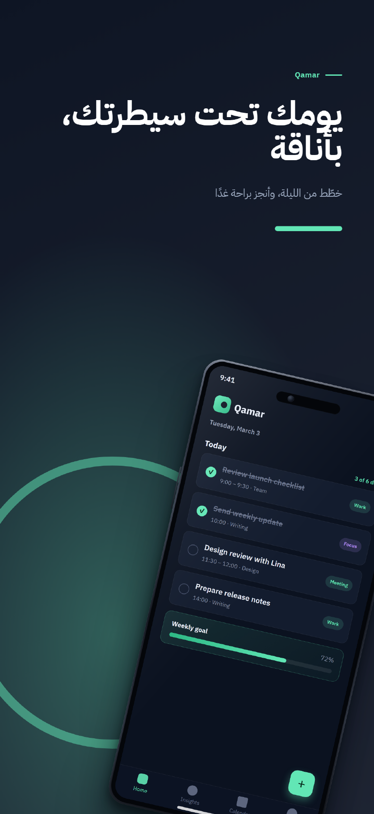 |

Arabic landscape headers, rendered through the RTL layout system (dedicated metrics, measured text, no clipped headlines): [`docs/gallery/families/*/l/ar/`](docs/gallery/families) · Landscape banners & Play feature graphics: [`docs/gallery/landscape`](docs/gallery/landscape) · Before/after vs v0.1: [`docs/before-after.md`](docs/before-after.md)

## How it compares

|  | StoreShot | fastlane frameit | cloud SaaS tools |
| --- | --- | --- | --- |
| Runs locally, offline | ✅ | ✅ (Ruby + ImageMagick) | ❌ uploads required |
| CLI / CI automation | ✅ | ✅ | Limited |
| Reusable JSON config | ✅ | Framefile.json | Per-project UI |
| Arabic / RTL typography | ✅ first-class | ❌ breaks ligatures | Rare |
| Reproducible pixels | ✅ | ❌ environment-dependent | ❌ |
| Price | Free, MIT | Free | Subscription |

## Documentation

| Topic | Link |
| --- | --- |
| Installation & configuration reference | [docs/configuration.md](docs/configuration.md) |
| Templates & authoring guide | [docs/templates.md](docs/templates.md) |
| Store export profiles (verified, dated) | [docs/store-profiles.md](docs/store-profiles.md) |
| Arabic & RTL behavior + troubleshooting | [docs/rtl-guide.md](docs/rtl-guide.md) |
| Launch & discoverability playbook | [docs/repo-seo.md](docs/repo-seo.md) |
| Contributing · Code of conduct · Security | [CONTRIBUTING.md](CONTRIBUTING.md) · [CODE_OF_CONDUCT.md](CODE_OF_CONDUCT.md) · [SECURITY.md](SECURITY.md) |

---

## Configuration highlights

```jsonc
{
  "$schema": "./node_modules/storeshot-cli/schema.json",
  "app": { "name": "Qamar", "story": "A calm task manager for people who plan tomorrow the night before." },
  "locales": ["en-US", "ar"],
  "template": "editorial",
  "theme": { "background": "#0E1524", "accent": "#62E6B5", "text": "#FFFFFF", "mode": "auto" },
  "screenshots": [
    {
      "id": "home",
      "role": "hero",                     // semantic role, shown in captions
      "image": "./screens/home.png",
      "title": { "en-US": "Your day, beautifully under control", "ar": "يومك تحت سيطرتك، بأناقة" }
    }
  ],
  "exports": [
    { "store": "app-store", "profile": "iphone-6-3" },
    { "store": "google-play", "profile": "phone" }
  ]
}
```

- `screenshots[].role` — optional semantic role (`hero`, `feature`, `workflow`, `trust`…) used by captions and layouts.
- `screenshots[].decor` — optional transparent PNG/WebP decorative assets (`{ "id", "image" }`) that composition templates place at computed positions and depths; missing files fail the build like missing screenshots.
- `app.category` + `"template": "auto"` — deterministic art direction: the declared store category, supplied decor and export orientation pick the template and print the rule that fired. An explicit `template` id always overrides.
- `theme.mode` — `auto` (derived from the background), `light` or `dark` to force shadow/contrast behavior; `theme.surface` overrides the elevated-panel token.
- Templates accept small, curated setting sets (`headlineScale`, `deviceScale`, `deviceMode`, and one or two template-specific options).

Full reference: [`docs/configuration.md`](docs/configuration.md) · Template API & authoring: [`docs/templates.md`](docs/templates.md).

## Apple creative assets: headers & search results

Apple's new product-page **header** and **search results** creatives are first-class exports — and because they are landscape, every template automatically switches to a dedicated landscape composition (text column + device column, RTL-aware):

| Header 21:9 (3840×1646) | Search results 3:2 (3840×2560) |
| --- | --- |
|  |  |

| Header in Arabic (RTL landscape) | Universal 16:9 (5244×2950, PNG-only) |
| --- | --- |
|  |  |

Google Play gets its own treatment too: the verified `feature-graphic` profile (1024×500) renders in the same landscape engine — see `docs/gallery/google-play/`. Apple profiles: `header-21-9`, `header-16-9` (one PNG covers header **and** search), `search-results-3-2`, plus `iphone-6-1` (1179×2556) and `preview-frame-6-3` (888×1920 poster frames — the preview itself must be video). Verified against Apple's official specifications on 2026-10-10 — see [`docs/store-profiles.md`](docs/store-profiles.md).

## Store profiles

Verified against official Apple/Google documentation (sources + dates in [`docs/store-profiles.md`](docs/store-profiles.md)): `iphone-6-3` 1206×2622 (required iPhone class), `iphone-6-9` 1320×2868, `ipad-13` 2064×2752, `phone` 1080×1920, `tablet` 1600×2560, plus validated custom sizes. Correct dimensions ≠ full compliance — the docs list what StoreShot cannot check.

## CLI & CI

```
storeshot init [dir] [--force] [--yes]    interactive project wizard
storeshot generate [-l locale…] [-e export…] [-o dir] [--allow-overflow]
storeshot validate [--json] [--fast]      config → assets → rendered text fit
storeshot templates                       the template library + settings
storeshot install                         download the rendering browser
```

Exit codes `0/1/2`; `validate --json` for pipelines; network requests are blocked inside the renderer; the same config + assets + version always produce the same pixels.

## What validation catches

Schema violations · missing/corrupt/unsupported/low-res sources · font fallbacks · missing translations (per screenshot, locale, field) · unknown templates, profiles and settings · custom-size rule violations · low title/background contrast · **rendered text overflow per locale × screenshot × export size**. It cannot judge taste or store policy — those stay yours.

## FAQ

**How is this different from fastlane frameit?** frameit frames one screenshot at a time with Ruby + ImageMagick and struggles with RTL text shaping; StoreShot renders whole listings — every locale and profile from one JSON config — through Chromium's text engine, so Arabic ligatures, bidi and mixed Arabic/English copy are correct by construction. It also validates geometry (clipped text fails the build) and covers Apple's newer creative assets and Play feature graphics as first-class profiles.

**Does it upload my screenshots anywhere?** No. Rendering is local with Chromium; the sandbox blocks all network requests. Nothing leaves your machine — that's a design constraint, not a setting.

**Does it work with Flutter / React Native / native apps?** Any app that can produce a PNG screenshot. The tool never inspects or modifies your app UI — it composes marketing around your real screenshots.

**Can I use my own fonts, colors and device frames?** Yes — brand colors, text and muted tones per config; per-screenshot `fit` and `focalPoint` cropping; templates with their own device presentation settings. Bundled fonts (IBM Plex Sans, IBM Plex Sans Arabic, Fraunces) are SIL OFL and redistributable.

**Will my text get cut off in another language?** The engine measures rendered text in the browser after fonts load, per locale × screenshot × export size, and fails with the exact field name if anything would clip the canvas, touch an edge, or overlap the device. Long Arabic headlines get their own layout budgets.

**Which store formats are supported?** App Store: iPhone 6.3"/6.1" portrait + landscape, 21:9 headers, 16:9 universal, 3:2 search creatives, 6.3" poster frames. Google Play: phone/tablet screenshots and the 1024×500 feature graphic. Dimensions are verified against the stores' published specs (see [docs/store-profiles.md](docs/store-profiles.md)).

## Development

```bash
npm install && npm run build && npx playwright-core install chromium
npm test              # unit + integration + visual regression
npm run test:visual:update   # refresh per-platform baselines deliberately
```

PRs welcome — new templates, verified store profiles, and Arabic/RTL edge cases above all. See [`CONTRIBUTING.md`](CONTRIBUTING.md), the [template guide](docs/templates.md), and [Discussions](https://github.com/saperaa/StoreShot/discussions) for questions and showcase posts.

## License

[MIT](LICENSE). Bundled fonts — IBM Plex Sans, IBM Plex Sans Arabic, Fraunces — are SIL Open Font License 1.1 ([license texts](assets/fonts/_licenses/)).
