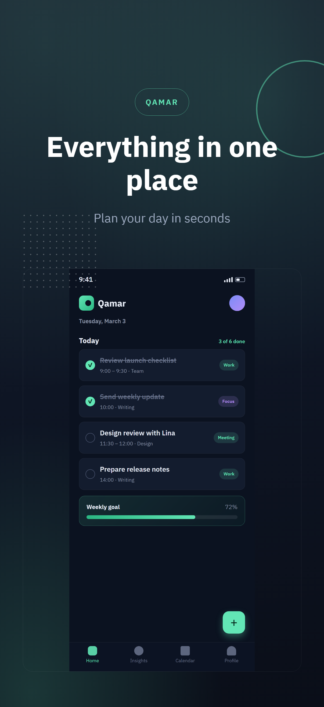
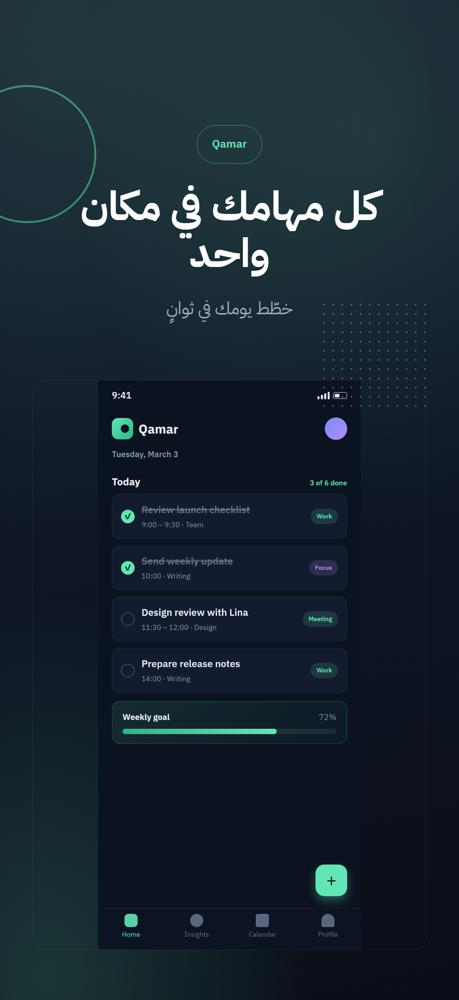
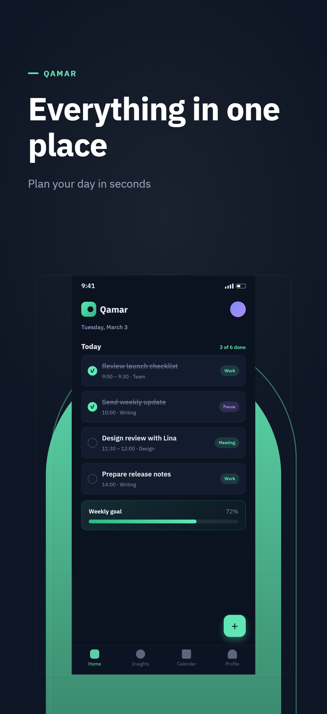
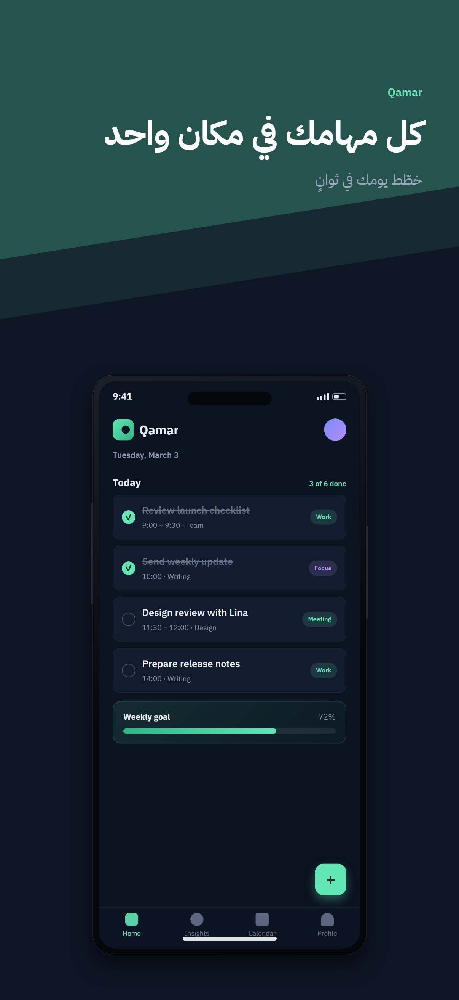
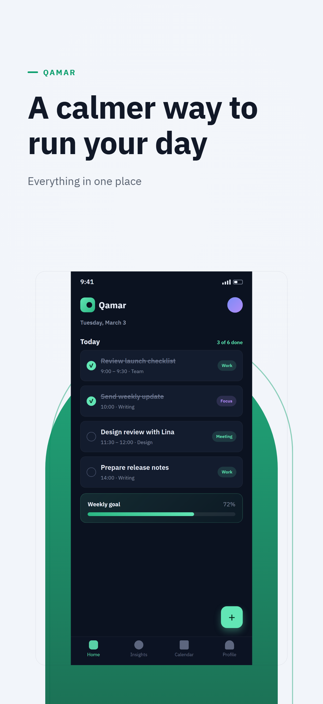
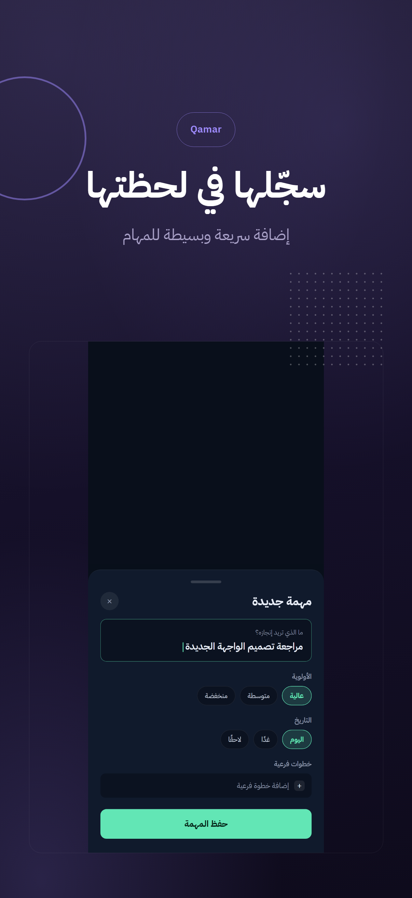

# StoreShot

**Professional, RTL-ready App Store & Google Play screenshots — from one JSON config, rendered locally.**

StoreShot turns your real app screenshots into polished store-listing frames for every locale you ship — with **Arabic and right-to-left text treated as a first-class feature**, not an afterthought. Deterministic, offline, no accounts, no uploads, no AI required.

```bash
npx storeshot-cli init my-app
npx storeshot-cli generate
```

---

## Why StoreShot

- **Arabic-first.** Correct letter shaping via Chromium's text engine, automatic `dir="rtl"` per locale, mirrored layouts through CSS logical properties, mixed Arabic/English/numerals handled natively — never by string reversal.
- **Deterministic & local.** Same assets + config + fonts + version ⇒ same pixels. Network requests are blocked during rendering. Nothing leaves your machine.
- **Fails loudly, not silently.** Missing files, bad dimensions, missing translations and text that doesn't fit its layout are caught _before_ you ship — with actionable messages naming the screenshot, locale and field.
- **Store profiles with receipts.** Sizes are verified against official Apple/Google documentation, with the verification date recorded in [`docs/store-profiles.md`](docs/store-profiles.md).
- **Developer-friendly.** JSON config with a published JSON Schema (autocomplete in VS Code), a `--json` validation mode for CI, and clean exit codes.

## Showcase

All images below were generated by this repository's CLI from the example project in [`starter/`](starter/) — the source "app" screenshots are original StoreShot artwork (a fictional tasks app, _Qamar_).

### Gradient

| English                                                                                      | العربية                                                                                  |
| -------------------------------------------------------------------------------------------- | ---------------------------------------------------------------------------------------- |
|  |  |

### Spotlight

| English                                                                                        | العربية                                                                                    |
| ---------------------------------------------------------------------------------------------- | ------------------------------------------------------------------------------------------ |
|  |  |

### Minimal


### Device Focus



### Theme presets (Spotlight · Daylight / Gradient · Deep Violet)

| Daylight                                                                               | Deep Violet                                                                           |
| -------------------------------------------------------------------------------------- | ------------------------------------------------------------------------------------- |
|  |  |

Regenerate everything above with:

```bash
git clone https://github.com/storeshot/storeshot && cd storeshot
npm install && npm run build && npx playwright-core install chromium
cd starter && node ../dist/cli.js generate
```

## Installation

```bash
npm install --save-dev storeshot-cli   # or: npx storeshot-cli@latest …
npx storeshot-cli install              # one-time Chromium download (~170 MB)
```

Requirements: **Node.js ≥ 20** (LTS recommended), Windows / macOS / Linux. The npm package name is `storeshot-cli` (`storeshot` was taken); the binary it installs is `storeshot`.

No Chromium? Point StoreShot at an installed browser instead:

```bash
STORESHOT_BROWSER_CHANNEL=msedge storeshot generate   # or "chrome"
```

## Quick start

```bash
storeshot init my-app        # asks what you want, wires up config + examples
cd my-app
storeshot generate           # renders every locale × export
storeshot validate           # checks config, assets, translations, text fit
```

`init` asks a few questions (app name, your app's story, locales, template, theme) whenever it runs in an interactive terminal — pass `--yes` to take the defaults, e.g. in CI.

### A 90-second tour

1. `storeshot init my-app` — starter project with working English + Arabic copy.
2. Drop your real screenshots into `my-app/screens/` (PNG/JPEG/WebP).
3. Edit titles/subtitles in `storeshot.config.json`.
4. `storeshot generate` → inspect `my-app/storeshots/`.

## Configuration

One file, `storeshot.config.json`, versioned and committed to Git. Full reference: [`docs/configuration.md`](docs/configuration.md).

```jsonc
{
  "$schema": "./node_modules/storeshot-cli/schema.json",
  "app": {
    "name": "Qamar",
    "story": "A calm task manager for people who plan their day the night before.",
  },
  "locales": ["en-US", "ar"],
  "template": "gradient",
  "theme": { "background": "#0E1524", "accent": "#62E6B5", "text": "#FFFFFF" },
  "screenshots": [
    {
      "id": "home",
      "image": "./screens/home.png",
      "title": { "en-US": "Everything in one place", "ar": "كل ما تحتاجه في مكان واحد" },
      "subtitle": { "en-US": "Plan your day in seconds", "ar": "خطّط يومك في ثوانٍ" },
    },
  ],
  "exports": [
    { "store": "app-store", "profile": "iphone-6-3" },
    { "store": "google-play", "profile": "phone" },
  ],
  "output": { "dir": "./storeshots" },
}
```

- `app.story` keeps your app's positioning next to the project so copy editors and translators always have context.
- Locales like `ar`, `he`, `fa`, `ur` … default to RTL automatically; override per locale with `"direction": { "ar": "ltr" }`.
- Output lands at `storeshots/<export>/<locale>/01-<id>.png`, ordered as in your config.

## Templates

| Template       | Look                                                           | Default device frame |
| -------------- | -------------------------------------------------------------- | -------------------- |
| `minimal`      | Editorial flat design, accent rule, generous whitespace        | no                   |
| `gradient`     | Layered glow fields, ring + dotted grid, centered type         | no                   |
| `device-focus` | Screenshot hero in a proportional device frame + tilted ribbon | **yes**              |
| `spotlight`    | Oversized accent arch behind the screenshot, huge headline     | no                   |

Every template works in every locale, mirrors correctly for RTL, and takes settings:

```json
"template": { "id": "gradient", "settings": { "glow": 0.8, "ring": false } }
```

`storeshot templates` lists them all. Authoring your own: [`docs/templates.md`](docs/templates.md).

## Store export profiles

Verified against official documentation — see [`docs/store-profiles.md`](docs/store-profiles.md) for sources and dates.

| Store       | Profile      | Pixels      | Notes                                 |
| ----------- | ------------ | ----------- | ------------------------------------- |
| App Store   | `iphone-6-3` | 1206 × 2622 | currently required iPhone size class  |
| App Store   | `iphone-6-9` | 1320 × 2868 | largest 6.9" class size               |
| App Store   | `ipad-13`    | 2064 × 2752 | required when the app supports iPad   |
| Google Play | `phone`      | 1080 × 1920 | within Play's 320–3840px / 2:1 limits |
| Google Play | `tablet`     | 1600 × 2560 | for tablet listings                   |

Custom sizes are supported (`exports[].size`); Google Play's published limits are enforced, App Store custom sizes get a warning because Apple only accepts official device sizes. **Dimensions alone don't make a listing compliant** — store policies (alpha channels, screenshot authenticity, minimum counts) are listed in the docs and are your responsibility.

## Arabic & RTL

- Shaping and bidi are delegated entirely to Chromium's text stack (HarfBuzz + ICU) — StoreShot never reorders or reverses strings.
- `<html lang dir>` is set from the locale; templates use CSS logical properties (`inset-inline-*`, `padding-inline-*`, `text-align: start`) so compositions mirror, not just right-aligned text.
- Mixed-direction text (Arabic + English product names, numerals, parentheses, currency) renders with the platform bidi algorithm.
- Text is measured _after_ fonts load; if a headline doesn't fit its layout budget, generation fails with the screenshot id, locale and field — nothing is silently shrunk or truncated.
- Bundled fonts: IBM Plex Sans + IBM Plex Sans Arabic (SIL OFL 1.1) so Arabic renders identically on every machine. Bring your own via `fonts.{latin,arabic}.{regular,semibold,bold}`.
- Troubleshooting guide: [`docs/rtl-guide.md`](docs/rtl-guide.md).

## CLI reference

```
storeshot init [dir] [--force] [--yes]   create a starter project (interactive)
storeshot generate [options]             render screenshots
storeshot validate [--json] [--fast]     validate everything (config → rendered text fit)
storeshot templates                      list templates + settings
storeshot install                        download the rendering browser
```

`generate` options: `-c/--config`, `-l/--locale <tags…>`, `-e/--export <selectors…>`, `-o/--output <dir>`, `--allow-overflow`.

Exit codes: `0` success · `1` configuration/validation problem · `2` rendering/runtime failure — CI-friendly.

## What validation catches (and what it can't)

Catches: schema violations, missing/corrupt/unsupported/low-res images, missing font files (with fallback), missing translations, unknown templates/profiles/settings, custom-size rule violations, low title↔background contrast, and rendered text overflow per locale × screenshot × export size.

Can't catch: subjective visual quality, store policy compliance, whether screenshots faithfully represent your app.

## Development

```bash
git clone https://github.com/storeshot/storeshot
npm install
npm run build          # compile + emit schema.json
npm test               # unit + integration + visual regression
npx playwright-core install chromium
```

Visual baselines are per-platform; regenerate deliberately with `npm run test:visual:update`. See [`CONTRIBUTING.md`](CONTRIBUTING.md) for the full guide.

## Contributing

Issues and pull requests are welcome — new templates, new store profiles (with verification dates!), and Arabic/RTL edge cases are especially valuable. Read [`CONTRIBUTING.md`](CONTRIBUTING.md) and the [template authoring guide](docs/templates.md) to start.

## License

[MIT](LICENSE). Bundled fonts are [IBM Plex](https://github.com/IBM/plex), SIL Open Font License 1.1 — see [`assets/fonts/_licenses/`](assets/fonts/_licenses/).
