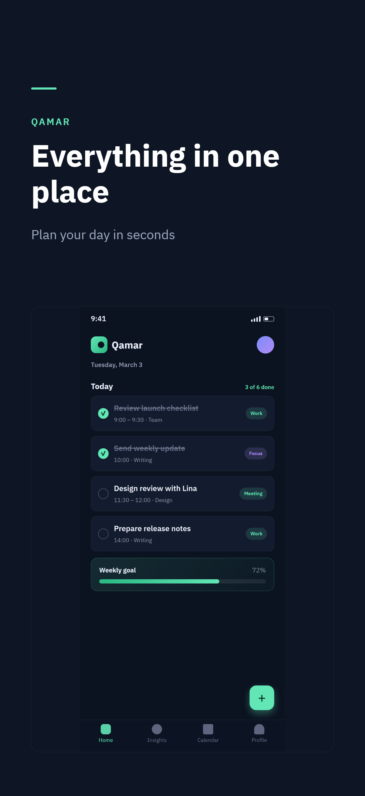
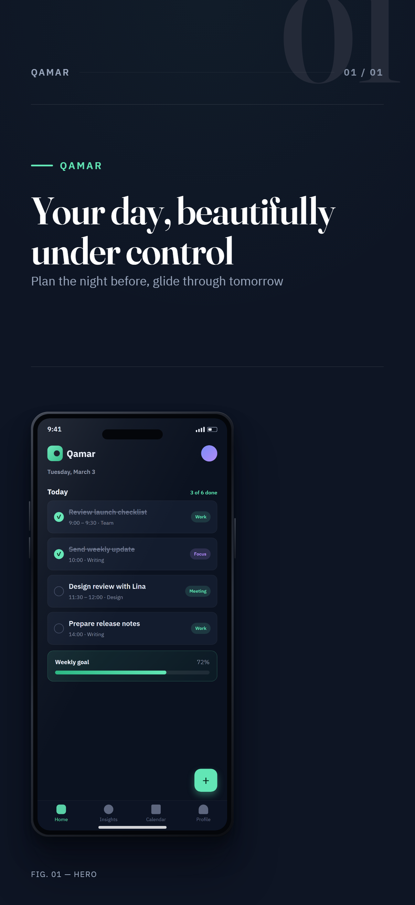
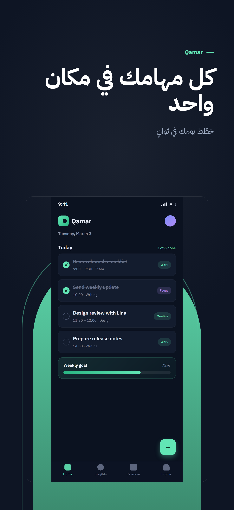
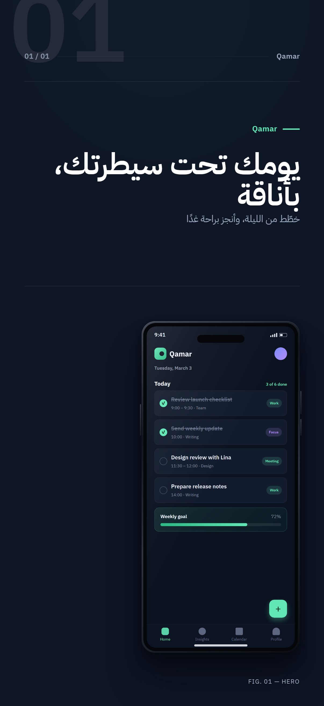
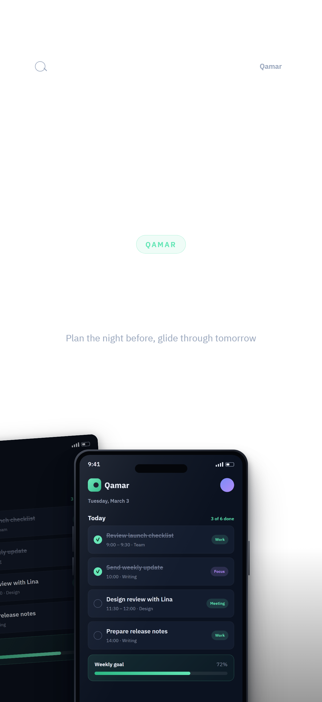

# Before / after — v0.1 → today

Same example app, same source screenshots, same CLI command. Left: the v0.1
templates (centered text on colored rectangles). Right: the current creative
system — art-directed templates, realistic device rendering, A/B sequence
layouts, and the Apple-inspired Discovery template with localized
interface-inspired layers. English and Arabic examples, all rendered by the
real CLI.

### v0.1 "gradient" → today's "campaign"

| v0.1 | Today |
| --- | --- |
|  |  |

### v0.1 "minimal" → today's "editorial"

| v0.1 | Today |
| --- | --- |
|  |  |

### Arabic, v0.1 "spotlight" → today's "editorial"

| v0.1 | Today |
| --- | --- |
|  |  |

### New in the current system — "discovery" (Apple-inspired, with a localized search layer)



Reproduce everything on the right:

```bash
npm install && npm run build && npx playwright-core install chromium
node scripts/build-gallery.mjs
```
