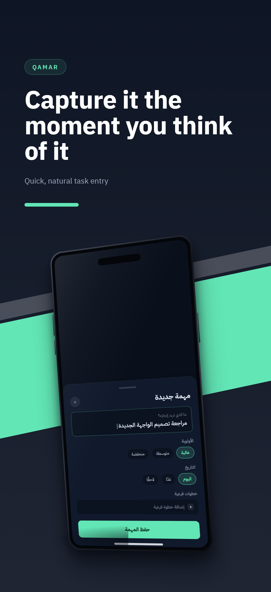
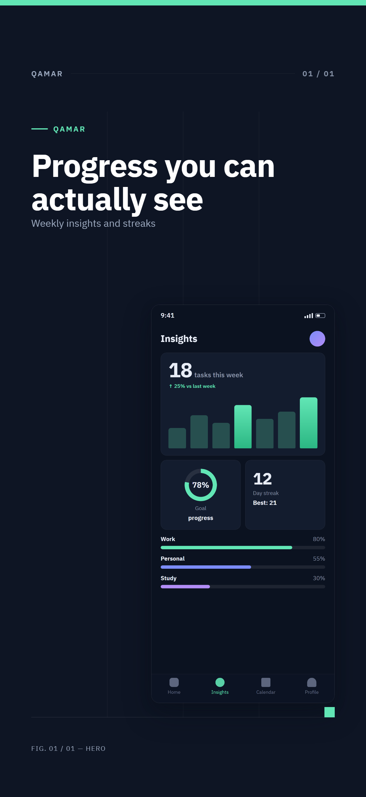
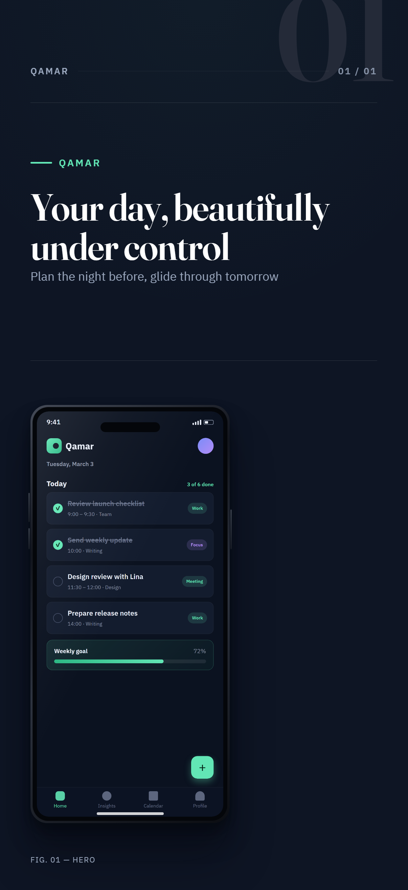

# Before / after — the v0.2 redesign

Same example app, same source screenshots, same CLI command. Left: v0.1
templates (centered text on colored rectangles, flat CSS "frames"). Right:
the v0.2 art-directed system (design tokens, realistic device rendering,
sequence-aware compositions).

### v0.1 "gradient" → v0.2 "campaign"

| Before | After |
| --- | --- |
|  |  |

### v0.1 "minimal" → v0.2 "swiss"

| Before | After |
| --- | --- |
|  |  |

### v0.1 "spotlight" → v0.2 "editorial"

| Before | After |
| --- | --- |
|  |  |

Reproduce the "after" column:

```bash
npm install && npm run build && npx playwright-core install chromium
node scripts/build-gallery.mjs
```

The old template ids still render (mapped to their redesigns, with a
deprecation notice); see the changelog for the mapping.
